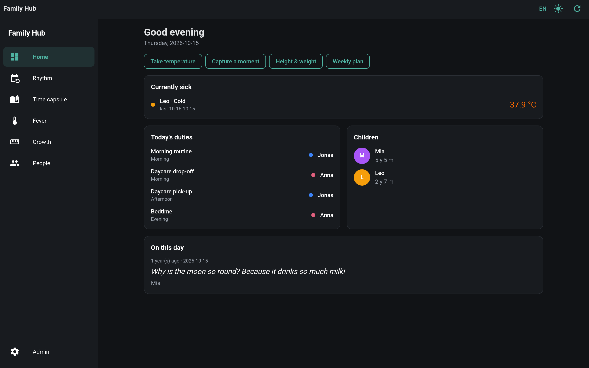
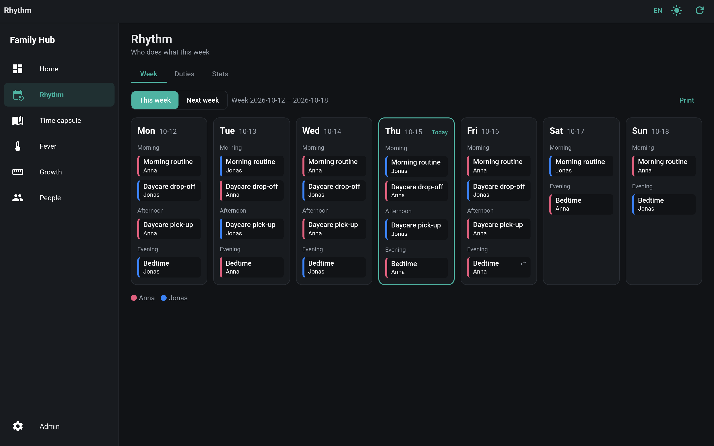
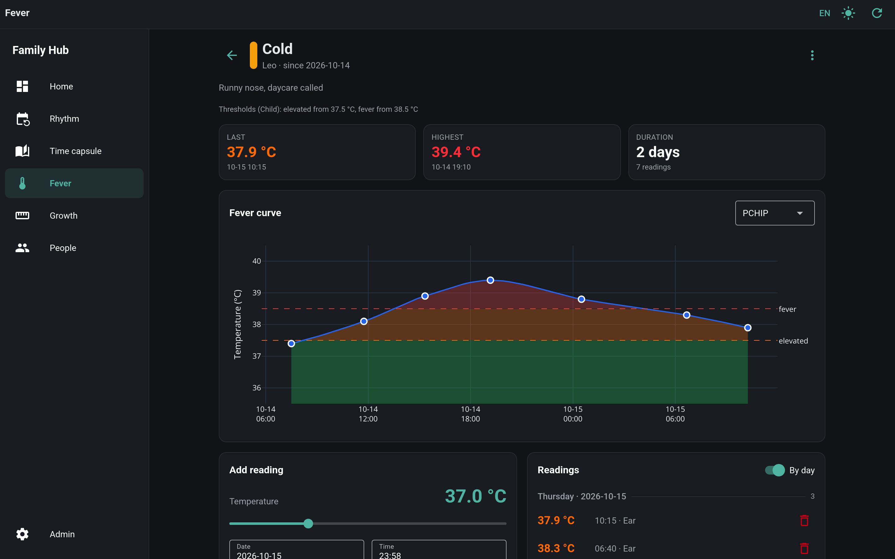
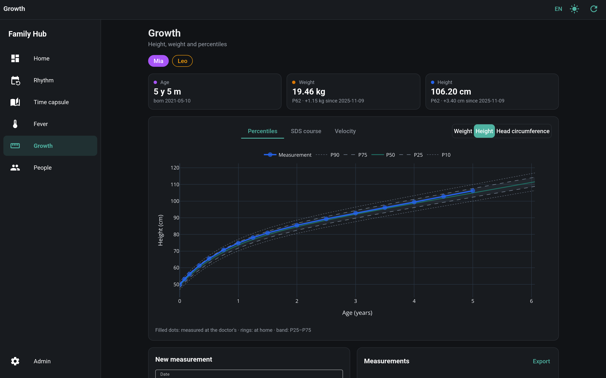
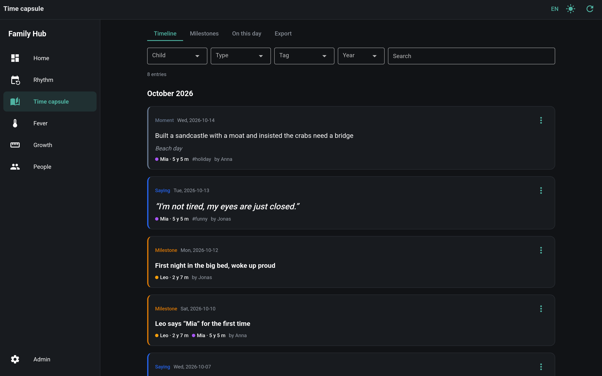
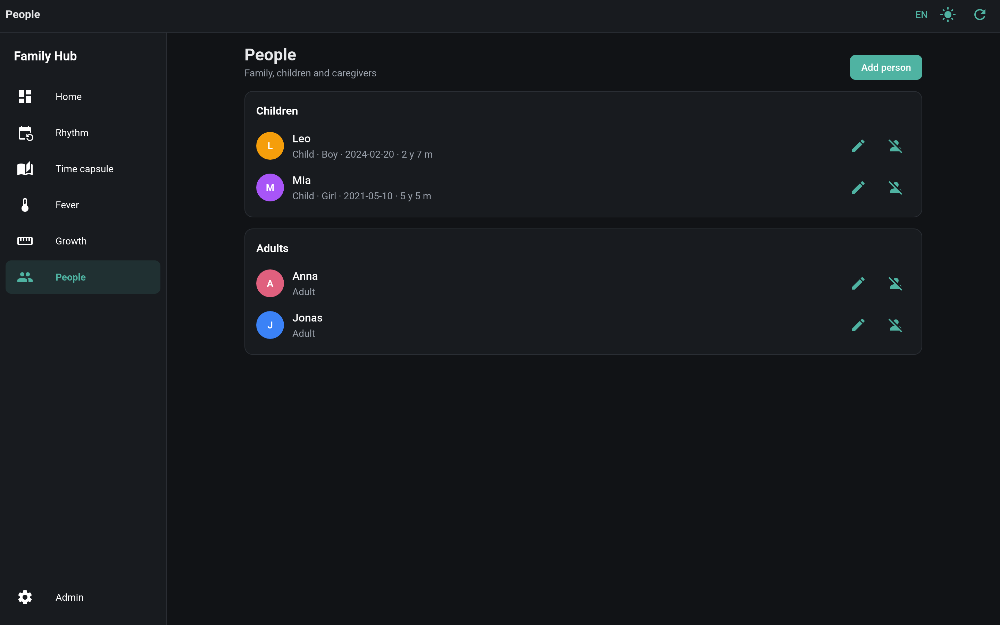

# Family Hub

A self-hosted web app for families: weekly duty plan, fever records, growth charts with percentiles and a journal of
memories, in one place. Runs as a single container with PostgreSQL. The UI is in German with an English switch and can
be installed as an app on phones.

## Prerequisites

- Docker with Compose
- For development: Python 3.13, [uv](https://docs.astral.sh/uv/) and `make`

## Getting started

```bash
cp .env.example .env    # set JWT_SECRET and STORAGE_SECRET, e.g. with `openssl rand -hex 32`
docker compose up -d --build
```

Open http://localhost:8080. A short checklist on the start page guides through the first steps (people, children,
duties).

For development, run the app on the host instead:

```bash
make install
make run        # starts PostgreSQL in Docker, the app on http://localhost:8080
make            # lists all commands
```

## Gallery

| | |
| --- | --- |
|  |  |
| Start page: today's duties, sick children, memories | Weekly duty plan with rotations and swaps |
|  |  |
| Fever curve with thresholds | Growth chart with percentiles |
|  |  |
| Time capsule: sayings, moments and milestones | People and children |

Demo data; the growth chart uses made-up reference curves.

## Configuration

All settings are environment variables, read from `.env`. [`.env.example`](.env.example) lists every one with a
short description; commented lines show the defaults.

A deployment needs at least `DATABASE_URL`, `JWT_SECRET` and `STORAGE_SECRET`. Behind a reverse proxy on a path
prefix, set `FORWARDED_PREFIX`.

## Login

Without further setup the app has no login and must only be reachable on a private network. To require a login,
use an OpenID Connect provider, for example [Pocket ID](https://pocket-id.org):

1. Create a client with PKCE, callback URL `<PUBLIC_URL>/auth/callback` and logout callback URL `<PUBLIC_URL>/`.
2. Set `AUTH_ENABLED=true`, `PUBLIC_URL`, `OIDC_ISSUER`, `OIDC_CLIENT_ID` and `OIDC_CLIENT_SECRET`.
3. Optional: `OIDC_ALLOWED_GROUPS` limits who may sign in, `OIDC_ADMIN_GROUPS` who may use the admin area.

For a local test, `docker compose --profile auth up -d pocket-id` starts Pocket ID on http://localhost:1411.

## API

The REST API is documented at `/api/docs`. Every endpoint needs a bearer token, issued in the admin area or with
`make token NAME=<client>`.

## Backups

Backups are gzipped JSON, stored locally and optionally in S3-compatible storage (`BACKUP_BUCKET` and the S3
variables). Create them in the admin area or with:

```bash
make backup-s3                                # skipped when nothing changed
make restore-list
make restore-s3 KEY=<prefix>/<file>.json.gz   # replaces all data
```

For scheduled backups, run the same image with `family-hub-backup --s3`. The local S3 from Docker Compose needs its
bucket once: `docker compose run --rm tools family-hub-backup --s3 --create-bucket`.

## Growth reference data

Percentiles and SDS need reference tables (LMS method), which are not included. Without them, growth charts show the
measurements only. Put one CSV per measurement and sex (`weight-girls.csv`, `length-boys.csv`, optionally
`head-…`) into a directory and set `GROWTH_REFERENCE_DIR`:

```text
age;unit;P3;P10;P25;P50;P75;P90;P97;L;S
0.0;Monate;...;...;...;...;...;...;...;;
2.0;Jahre;...;...;...;...;...;...;...;0.85;0.04
```

`L` and `S` may be empty; they are then fitted from the percentiles.

## Deployment

Build and push the image with `make release` (set `REGISTRY` in `.env`). Run exactly one replica. Probes:
`/api/healthz` (liveness) and `/api/readyz` (readiness, checks the database and schema). Migrations run on start.

## Development

`make check` runs everything CI runs: lint, formatting, type check and all tests. `make test` runs only the unit
tests, which need no database; `make test-integration` starts PostgreSQL and runs the rest.

## Third-party assets

The PDF export embeds [Noto Emoji](https://fonts.google.com/noto/specimen/Noto+Emoji) (SIL Open Font License 1.1) and
DejaVu Sans (shipped with matplotlib).
